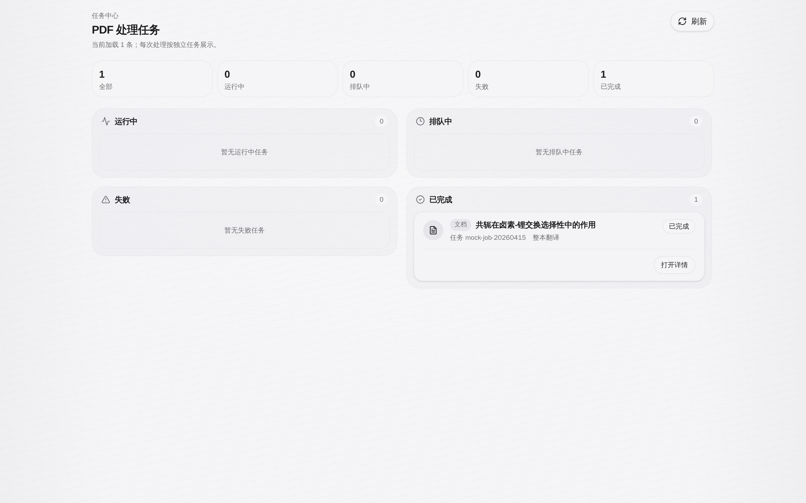
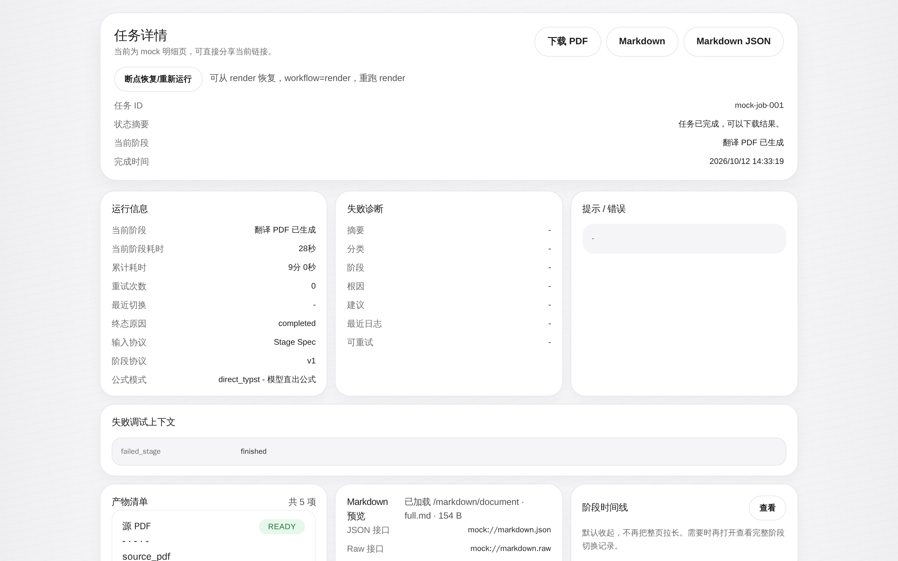
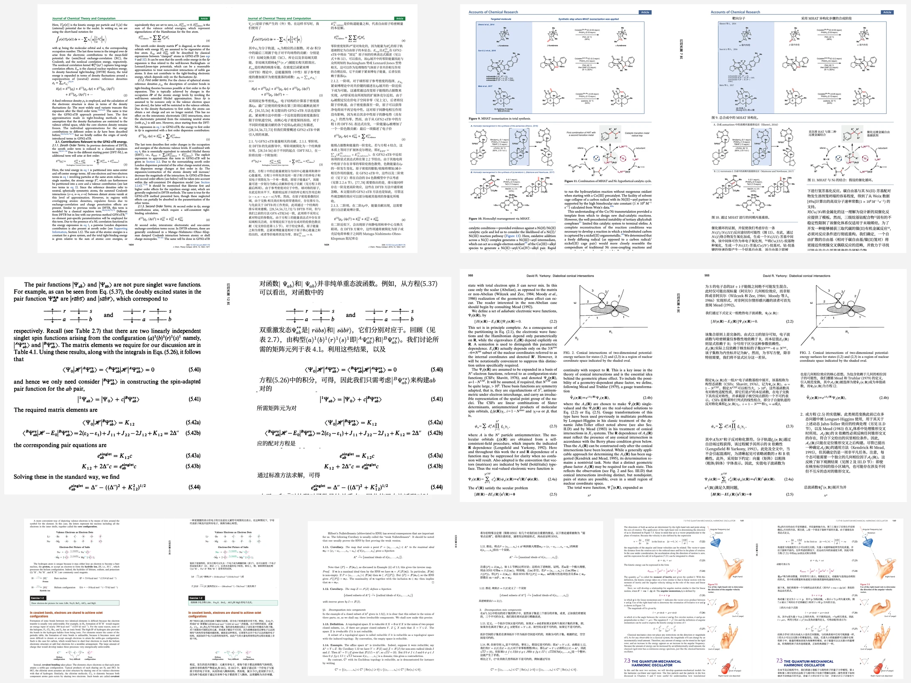

# RetainPDF：PDF 保留排版翻译工具

<p align="center">
  <a href="README.md">中文</a> · <a href="README.en.md">English</a> · <a href="README.vi.md">Tiếng Việt</a>
</p>

<p align="center">
  
</p>

RetainPDF 是目前唯一面向图片型 / 扫描版 PDF、支持保留排版翻译的开源项目，翻译与排版效果对标甚至超过同类商业产品。

自研字体排版算法，支持复杂公式与多栏论文的版式还原。扫描 PDF 翻译、PDF 结构优化、代码保护、自定义翻译策略和开放 API，一并支持。

翻译系统同样自研，针对跨栏、跨页、断句和段落续接等 PDF 常见难题做了专门处理：先恢复完整语义单元，再进行翻译，避免逐框翻译造成的上下文割裂。

**在行内公式部分 RetainPDF 的断层领先：翻译后仍能稳定保留公式本体、前后文关系与行内排版，这是其他开源 PDF 翻译项目目前做不到的。**

代码、API 与部署方式全部开放，支持自部署和二次开发。

核心能力对比：

| 项目 | 扫描型 PDF | 复杂行内公式 | 代码不误翻 | 表格控制 | 自定义翻译策略 | 排版保留 | PDF 压缩优化 | API 自动化 |
| --- | --- | --- | --- | --- | --- | --- | --- | --- |
| PDFMathTranslate | ❌ | ❌ | ❌ | 弱 | 弱 | 一般 | 一般 | ✅ |
| PolyglotPDF | ❌ | ❌ | ❌ | 弱 | 弱 | 一般 | 一般 | ✅ |
| Doc2X | ✅ | ✅ | ❌ | 中 | 弱 | 强 | 弱 | ❌ 不开放 |
| RetainPDF | ✅ | ✅ 强保留 | ✅ | ✅ 可开关 | ✅ 可按规则配置 | 强 | ✅ 持续优化 | ✅ |

## 产品界面

网页端聚焦任务进度：任务经开放 API 提交（自研调用、脚本或 [Zotero 插件](plugin/)），在网页上集中查看执行状态与产物。

### 任务列表

按 运行 / 排队 / 失败 / 完成 分组集中查看全部任务，行内进度与取消/重试。

<p align="center">
  
</p>

### 任务详情

单任务的阶段进度、失败诊断、事件时间线与产物下载。

<p align="center">
  
</p>

## 翻译效果

SCI 论文、图片型 / 扫描版 PDF 与图书教材的原文—译文对照样例：

<p align="center">
  
</p>

<p align="center"><sub>第一行：SCI 论文 · 第二行：扫描与公式密集文档 · 第三行：图书教材</sub></p>

## 快速开始

### Docker 部署

```bash
git clone https://github.com/Hao-IANWY/zotero-retainpdf-plugin.git
cd retain-pdf/ops/deployment/docker/delivery
docker compose up -d
```

启动后访问 <http://127.0.0.1:40001> 查看任务状态，默认拉取本仓库发布在
GHCR 的镜像。想跟随最新源码或自定制，可本地构建替换：

```bash
cd <仓库根目录>
docker build --build-arg TYPST_VERSION=0.15.1 \
  -f ops/deployment/docker/backend/Dockerfile.app -t retainpdf-app:local .
docker build --build-arg RETAIN_PDF_VERSION=local \
  -f ops/deployment/docker/Dockerfile.web -t retainpdf-web:local .
cd ops/deployment/docker/delivery
APP_IMAGE=retainpdf-app:local WEB_IMAGE=retainpdf-web:local docker compose up -d
```

首次构建约 10–20 分钟（270 个 Rust crate），之后有分层缓存、秒级增量。
若数据目录属主与容器默认用户（uid 1000）不一致，构建时加
`--build-arg RETAINPDF_UID=<你的uid> --build-arg RETAINPDF_GID=<你的gid>`。

更新服务（用自己镜像时重建即更新）：

```bash
git pull
# 重新执行上面的 build 与 compose up -d
```

更多配置（端口、密钥、反代）见 [Docker 部署说明](ops/deployment/docker/delivery/README.md)。

### Zotero 插件安装

Zotero 7+ 中打开 `工具 → 插件 → 齿轮菜单 → Install Plugin From File`，选择
[最新版 xpi](https://github.com/Hao-IANWY/zotero-retainpdf-plugin/releases/latest/download/retain-pdf.xpi)。
装好后先到设置里填服务地址与凭据（或改用[插件目录](plugin/)自行构建）。

## 开发

参阅 [贡献指南](CONTRIBUTING.md)、[项目文档](docs/README.md)和[后端说明](backend/README.md)。

## 致谢

本项目衍生自 [wxyhgk/retain-pdf](https://github.com/wxyhgk/retain-pdf)，并在其基础上独立演进。感谢上游作者的开源贡献。

## License

- 本仓库自有代码：MIT（见 [LICENSE](LICENSE)）
- `plugin/`（Zotero 插件）：AGPL-3.0-or-later，基于
  [zotero-plugin-template](https://github.com/windingwind/zotero-plugin-template)
- 运行时依赖 PyMuPDF 为 AGPL-3.0：自行部署即视为使用 AGPL 软件，请遵守其
  许可条款。预构建镜像发布在 GHCR（`ghcr.io/hao-ianwy/retainpdf-app` /
  `retainpdf-web`），与本仓库源码一一对应；AGPL 要求下，镜像使用者同样可以
  在本仓库获取完整对应源码
