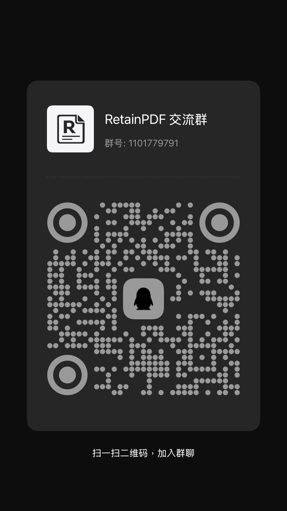

# RetainPDF: Công cụ dịch PDF giữ nguyên bố cục

<p align="center">
  <a href="README.md">中文</a> · <a href="README.en.md">English</a> · <a href="README.vi.md">Tiếng Việt</a>
</p>

<p align="center">
  
</p>

RetainPDF hiện là dự án mã nguồn mở duy nhất dành cho việc dịch PDF dạng ảnh và bản quét mà vẫn giữ nguyên bố cục, với chất lượng dịch thuật và sắp chữ ngang bằng, thậm chí vượt qua các sản phẩm thương mại cùng loại.

Thuật toán sắp chữ tự phát triển giúp khôi phục công thức phức tạp và bố cục bài báo nhiều cột. Dịch PDF quét, tối ưu cấu trúc PDF, bảo vệ mã nguồn, chiến lược dịch tùy chỉnh và API mở đều được hỗ trợ.

Hệ thống dịch thuật cũng do dự án tự phát triển, với xử lý chuyên biệt cho nội dung chạy qua nhiều cột hoặc nhiều trang, câu bị ngắt và đoạn văn nối tiếp. Hệ thống khôi phục đơn vị ngữ nghĩa hoàn chỉnh trước khi dịch, thay vì dịch từng khung OCR rời rạc và làm mất ngữ cảnh.

**Công thức nội dòng là lợi thế vượt trội của RetainPDF: công thức, văn bản xung quanh và bố cục nội dòng vẫn được giữ ổn định sau khi dịch—điều mà các dự án dịch PDF mã nguồn mở khác hiện chưa làm được.**

Mã nguồn, API và phương thức triển khai đều hoàn toàn mở, hỗ trợ tự triển khai và phát triển mở rộng.

So sánh năng lực cốt lõi:

| Dự án | PDF quét | Công thức nội dòng phức tạp | Không dịch nhầm mã nguồn | Kiểm soát bảng | Chiến lược dịch tùy chỉnh | Giữ bố cục | Tối ưu dung lượng PDF | Tự động hóa qua API |
| --- | --- | --- | --- | --- | --- | --- | --- | --- |
| PDFMathTranslate | ❌ | ❌ | ❌ | Hạn chế | Hạn chế | Trung bình | Trung bình | ✅ |
| PolyglotPDF | ❌ | ❌ | ❌ | Hạn chế | Hạn chế | Trung bình | Trung bình | ✅ |
| Doc2X | ✅ | ✅ | ❌ | Khá | Hạn chế | Tốt | Hạn chế | ❌ Không công khai |
| RetainPDF | ✅ | ✅ Bảo toàn vượt trội | ✅ | ✅ Tùy chọn | ✅ Theo quy tắc | Tốt | ✅ Liên tục cải thiện | ✅ |

## Giao diện sản phẩm

Giao diện web tập trung vào tiến độ tác vụ: tác vụ được gửi qua API mở (script, tích hợp hoặc [plugin Zotero](plugin/)), và các trang web hiển thị tập trung trạng thái cùng sản phẩm.

### Danh sách tác vụ

Tất cả tác vụ được nhóm theo đang chạy / chờ / thất bại / hoàn thành, kèm tiến độ, hủy và thử lại ngay trên dòng.

<p align="center">
  
</p>

### Chi tiết tác vụ

Tiến độ từng giai đoạn, chẩn đoán lỗi, dòng thời gian sự kiện và tải sản phẩm của một tác vụ.

<p align="center">
  
</p>

## Ví dụ bản dịch

Các ví dụ đối chiếu bản gốc và bản dịch cho bài báo khoa học, PDF quét, tài liệu có nhiều công thức và sách:

<p align="center">
  
</p>

<p align="center"><sub>Hàng 1: bài báo khoa học · Hàng 2: tài liệu quét và nhiều công thức · Hàng 3: sách và giáo trình</sub></p>

## Bắt đầu nhanh

### Docker

```bash
git clone https://github.com/wxyhgk/retain-pdf.git
cd retain-pdf/ops/deployment/docker/delivery
docker compose up -d
```

Sau khi khởi động, mở <http://127.0.0.1:40001>. Để cập nhật:

```bash
docker compose pull
docker compose up -d
```

Xem [hướng dẫn triển khai Docker](ops/deployment/docker/delivery/README.md) để biết thêm tùy chọn.

## Cộng đồng

Nhóm QQ: `1101779791`

<p align="center">
  
</p>

## Phát triển

Xem [hướng dẫn đóng góp](CONTRIBUTING.md), [tài liệu dự án](docs/README.md) và [hướng dẫn backend](backend/README.md).

## Giấy phép

Dự án được phát hành theo giấy phép MIT. Xem toàn bộ nội dung tại [LICENSE](LICENSE).
